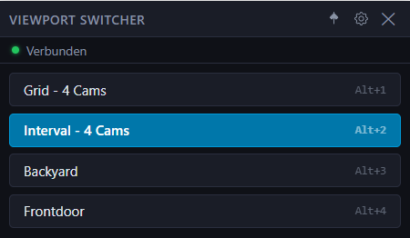

# UniFi Viewport Liveview Switcher

A compact, always-on-top desktop widget for Windows that lets you switch the active liveview on a UniFi Protect Viewport with a single click.

## Features

- One-click liveview switching directly from the desktop
- Minimal frameless widget — stays out of the way
- Optional always-on-top pinning
- Password-protected settings panel
- TLS skip support for self-signed NVR certificates

## Requirements

- Windows 10 / 11
- UniFi Protect NVR reachable on the local network
- A UniFi Protect API key (generated in the Protect web UI under **Settings → API**)
- At least one Viewport device and one saved Liveview in your Protect setup

## Quick Start

1. Download the latest installer from [Releases](../../releases).
2. Run the installer and launch the app.
3. Click the gear icon → set an admin password on first launch.
4. In the Settings window, enter your NVR IP and API key, click **Connect & Fetch**.
5. Select the Viewport you want to control, then click **Load Liveviews**.
6. Check the liveviews you want to appear as buttons, optionally give them custom names.
7. Click **Save Settings**. Buttons appear in the widget immediately.

## Development

See [docs/development.md](docs/development.md) for build instructions.

## Architecture

See [docs/architecture.md](docs/architecture.md) for a full technical overview.

## IPC API

See [docs/ipc-api.md](docs/ipc-api.md) for the full IPC channel reference.

## License

GPL-3.0-or-later
